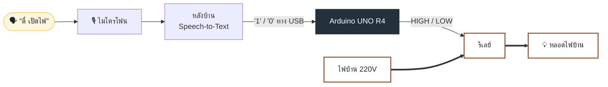

<p align="center">
  
</p>

<p align="center">
  
  
  
  
  
</p>

<p align="center">
  <b><a href="https://weloveptae.github.io/lantern/">ดูเว็บพรีเซนต์</a></b>
</p>

---

## LANTERN คืออะไร

**LANTERN** คือโคมไฟอัจฉริยะที่ฟังเสียงเราได้ แค่เรียกชื่อ **“ตี๋”** แล้วต่อด้วย **“เปิด”** หรือ **“ปิด”** ระบบจะสั่ง Arduino UNO R4 ให้รีเลย์ต่อหรือตัดไฟ หลอดไฟบ้าน 220V ก็ติดหรือดับ ไม่ต้องลุกไปกดสวิตช์

| ปัญหา | ทางแก้ของเรา |
| --- | --- |
| นอนอยู่บนเตียงแล้วต้องลุกไปปิดไฟ | พูดสั่งได้จากตรงที่อยู่ |
| ถือของอยู่ มือไม่ว่าง | ไม่ต้องใช้มือเลย |
| ผู้สูงอายุเดินไปกดสวิตช์ลำบาก | สั่งด้วยเสียงแทนการเดินไปกด |

## การทำงาน



1. ผู้ใช้พูดคำปลุก **“ตี๋”** แล้วต่อด้วย **“เปิด”** หรือ **“ปิด”**
2. ไมโครโฟนส่งเสียงให้หลังบ้าน ซึ่งแปลงเสียงเป็นข้อความด้วย Speech-to-Text
3. หลังบ้านเช็กว่ามีคำว่า “ตี๋” ไหม ถ้ามี ดูคำถัดไปว่าเปิดหรือปิด แล้วส่ง `'1'` หรือ `'0'` ให้ Arduino ทางสาย USB ถ้าไม่มีคำปลุกจะไม่ทำอะไร
4. Arduino UNO R4 ส่ง HIGH (เปิด) หรือ LOW (ปิด) ไปที่ขา IN ของรีเลย์
5. รีเลย์ต่อวงจร 220V หลอดไฟบ้านติด หรือตัดวงจร หลอดดับ

> ฝั่งสั่งงาน (ไมค์ หลังบ้าน Arduino) ใช้ไฟต่ำ ฝั่งไฟบ้าน 220V วิ่งผ่านรีเลย์ไปหลอด รีเลย์แยกสองฝั่งออกจากกันด้วยขดลวดข้างใน ไม่มีสายต่อถึงกันตรงๆ

## อุปกรณ์

| อุปกรณ์ | ใช้ทำอะไร | จำนวน |
| --- | --- | :---: |
| Arduino UNO R4 | รับคำสั่งจากหลังบ้านแล้วสั่งรีเลย์ | 1 |
| ไมโครโฟน | รับเสียงพูดของผู้ใช้ | 1 |
| คอมพิวเตอร์ (หลังบ้าน) | แปลงเสียงเป็นข้อความ เช็กคำปลุก แล้วส่งคำสั่งให้ Arduino | 1 |
| โมดูลรีเลย์ 5V | สวิตช์ที่ให้ Arduino เปิด-ปิดไฟ 220V ได้ | 1 |
| หลอดไฟบ้าน + ขั้ว E27 | โหลดที่เราควบคุม | 1 |
| สายไฟ VAF + ปลั๊กตัวผู้ | เดินไฟ 220V จากเต้ารับ | 1 ชุด |
| สายจัมเปอร์ / บอร์ดทดลอง | ต่อรีเลย์กับ Arduino | 1 ชุด |

## โค้ดหลัก

**หลังบ้าน (Python)** ฟังเสียง แปลงเป็นข้อความ เช็กคำปลุก แล้วส่งคำสั่ง

```python
import serial
import speech_recognition as sr

arduino = serial.Serial("COM3", 9600)   # พอร์ตของ Arduino
recognizer = sr.Recognizer()

with sr.Microphone() as mic:
    while True:
        audio = recognizer.listen(mic)
        try:
            text = recognizer.recognize_google(audio, language="th-TH")
        except sr.UnknownValueError:
            continue

        if "ตี๋" not in text:          # ไม่มีคำปลุก ไม่ทำอะไร
            continue
        command = text.split("ตี๋", 1)[1]

        # เช็ก "เปิด" ก่อน เพราะคำว่า "เปิด" มี "ปิด" อยู่ข้างใน
        if "เปิด" in command:
            arduino.write(b"1")
        elif "ปิด" in command:
            arduino.write(b"0")
```

**Arduino** รอรับคำสั่งแล้วสั่งรีเลย์

```cpp
const int RELAY_PIN = 7;

void setup() {
  Serial.begin(9600);              // รับคำสั่งจากหลังบ้านทาง USB
  pinMode(RELAY_PIN, OUTPUT);
  digitalWrite(RELAY_PIN, LOW);     // เริ่มต้นไฟดับ
}

void loop() {
  if (Serial.available()) {
    char cmd = Serial.read();

    if (cmd == '1') digitalWrite(RELAY_PIN, HIGH);   // เปิดไฟ
    if (cmd == '0') digitalWrite(RELAY_PIN, LOW);    // ปิดไฟ
  }
}
```

## ⚠️ ความปลอดภัย

โปรเจคนี้ใช้ไฟบ้าน 220V ซึ่ง**อันตรายถึงชีวิต**

- ถอดปลั๊กก่อนแตะสายไฟทุกครั้ง
- ฝั่ง Arduino กับฝั่ง 220V แยกกันด้วยรีเลย์ ไม่ต่อสายถึงกันตรงๆ
- หุ้มขั้วต่อ 220V ทุกจุด ไม่ให้มีทองแดงโผล่
- ทดสอบคำสั่งเสียงกับรีเลย์ตอนยังไม่เสียบปลั๊กก่อน (ฟังเสียงรีเลย์ดังแกร๊ก) แล้วค่อยต่อไฟจริง

## เว็บพรีเซนต์

เว็บอยู่ที่ [`index.html`](index.html) เป็นหน้าเดียว ส่วนการทำงานมีแผนผังที่ชี้หรือแตะแต่ละกล่องและเส้นเพื่อดูรายละเอียดได้ คลิกหลอดไฟในหน้าแรกเพื่อเปิด-ปิดไฟบนจอ

รันในเครื่อง:

```bash
python3 -m http.server
# แล้วเปิด http://localhost:8000
```

## ทีม

| | ชื่อ | รหัสนักศึกษา | หน้าที่ |
| :---: | --- | --- | --- |
| 🟤 | ชื่อ นามสกุล | 68070013 | หัวหน้าทีม |
| 🔵 | ชื่อ นามสกุล | 68070014 | เขียนโค้ด |
| 🟢 | ชื่อ นามสกุล | 68070006 | ต่อวงจร |
| 🟡 | ชื่อ นามสกุล | 680700xx | ออกแบบชิ้นงาน |
| ⚫ | ชื่อ นามสกุล | 680700xx | เอกสาร / พรีเซนต์ |

---

<p align="center"><sub>LANTERN · วิชา Physical Computing ภาคเรียนที่ 1/2569</sub></p>
